<!-- Everything in /assets is a self-made animated SVG (CSS + SMIL, no scripts or external fonts), so it animates on GitHub. -->

<picture>
  <source media="(prefers-color-scheme: dark)" srcset="https://readme-typing-svg.demolab.com?font=Fira+Code&weight=600&size=22&duration=2800&pause=900&color=00D9FF&center=true&vCenter=true&width=760&height=46&lines=Data+Analyst+%C2%B7+Data+Scientist+%C2%B7+Educator;I+turn+messy+data+into+decisions;Taught+O%2FL+Maths+%26+Science+for+5%2B+years;Researching+which+AI+wrote+a+text;Future+university+professor+%F0%9F%8E%93">
  <source media="(prefers-color-scheme: light)" srcset="https://readme-typing-svg.demolab.com?font=Fira+Code&weight=600&size=22&duration=2800&pause=900&color=0E7490&center=true&vCenter=true&width=760&height=46&lines=Data+Analyst+%C2%B7+Data+Scientist+%C2%B7+Educator;I+turn+messy+data+into+decisions;Taught+O%2FL+Maths+%26+Science+for+5%2B+years;Researching+which+AI+wrote+a+text;Future+university+professor+%F0%9F%8E%93">
  
</picture>

 

## 👋 About me

I'm a **data analyst** who likes the whole journey: cleaning messy records, finding the real question, building the
model, and explaining the answer so people can act on it.



## 🚀 Featured projects

Click a card to open the repository. The numbers come from each project's own tests and benchmarks.

<a href="https://github.com/harshadulshan/llm-model-attribution-thesis"></a>
<a href="https://github.com/harshadulshan/electricity-theft-detector"></a>
<a href="https://github.com/harshadulshan/code-plagiarism-detector"></a>
<a href="https://github.com/harshadulshan/market-risk-dashboard"></a>
<a href="https://github.com/harshadulshan/lit-review-screener"></a>
<a href="https://github.com/harshadulshan/exam-timetabler"></a>

<b>🧪 6 more projects</b>: exam questions, inventory, outbreaks, climate, earthquakes, air quality

 

<a href="https://github.com/harshadulshan/exam-question-analytics"></a>
<a href="https://github.com/harshadulshan/demand-inventory-optimizer"></a>
<a href="https://github.com/harshadulshan/outbreak-surveillance"></a>
<a href="https://github.com/harshadulshan/climate-trend-analyzer"></a>
<a href="https://github.com/harshadulshan/aftershock-forecaster"></a>
<a href="https://github.com/harshadulshan/air-quality-dashboard"></a>

## 🧭 My journey


<b>💼 Experience details</b>

 

**📊 Data Analyst Intern** · S & S Power Solutions Lanka (Pvt) Ltd · Jul – Dec 2025
- Audited data and resolved duplicate and inconsistent records; built a centralized customer database
- Sales analysis, customer segmentation and cross-selling; inventory monitoring and demand forecasting
- Dashboards and reports in **Excel** and **Power BI**

**👨‍🏫 Mathematics & Science Teacher** (G.C.E. O/L) · 5+ years
- English and Sinhala medium at Zenith Educational Institute (Piliyandala), Sylvester Institute (Mount Lavinia) and
  Aruna Institute (Halpita), after starting with individual tuition
- Turning exam results into insight led to the **Exam Question Analytics** project

**🏗️ Kaldera Construction**
- Manage a construction business; built a digital workflow for project timelines, resources and financial reporting
  (SQL Server, Excel)

## 🛠️ Toolbox


## ✍️ Research & writing

- 🎓 **Thesis:** stylometric attribution of LLM-generated text under rewriting pressure. 1,196 samples from 4 models
  across 4 domains, rewritten lightly and heavily; an XGBoost + Random Forest + MLP ensemble with SHAP. Journal
  submission planned for November 2026.
- 🖼️ **Now exploring** on [Kaggle](https://www.kaggle.com/harshakaldera): recovering AI-edited images with Segment
  Anything Model 3 (SAM 3), plus data engineering and quantitative finance.
- 🆔 **ORCID:** [0009-0009-5824-0051](https://orcid.org/0009-0009-5824-0051)

**📝 Latest on [Medium](https://medium.com/@harshakaldera540)**
<!-- BLOG-POST-LIST:START -->
- [Nobody Prepared Me for the Morning After Graduation](https://medium.com/@harshakaldera540/nobody-prepared-me-for-the-morning-after-graduation-648823b109d1) · Oct 24, 2026
<!-- BLOG-POST-LIST:END -->

## 📜 Certifications

<b>14 certificates</b> from Google, Microsoft, IBM, AWS, Duke University and HP LIFE · click to see and verify

 

| Issuer | Certificate |
|---|---|
| **Google** | [Foundations of Data Science](https://coursera.org/verify/8GM95T8UUK4M) · [The Power of Statistics](https://coursera.org/verify/KSMNQB0XNFBK) · [Go Beyond the Numbers](https://coursera.org/verify/HU28DLILMLOM) · [Share Data Through the Art of Visualization](https://coursera.org/verify/BMAH9UIK7CUP) |
| **Microsoft** | [Preparing Data for Analysis with Microsoft Excel](https://coursera.org/verify/KAFB1RBX0V9F) · [Harnessing the Power of Data with Power BI](https://coursera.org/verify/L8MZ4GOR3BFJ) |
| **IBM** | [Generative AI: Elevate Your Data Science Career](https://coursera.org/verify/W5OAT4HXE15N) · [Generative AI Essentials for Data Science](https://www.credly.com/badges/b5b2dfb0-96ab-4093-84ec-f4b962e5ec58) (Credly) |
| **AWS** | [AWS Cloud Practitioner Essentials](https://coursera.org/verify/PP4GH01DTTQM) · [Exam Prep: AWS Certified Solutions Architect – Associate](https://coursera.org/verify/P2GH1RZ43QQI) |
| **Duke University** | [Introduction to Probability and Data with R](https://coursera.org/verify/XJTFD08XUN9F) |
| **HP LIFE** | Data Science & Analytics · Presenting Data · AI for Business Professionals |

All earned in 2026.

## 📊 GitHub activity

<picture>
  <source media="(prefers-color-scheme: dark)" srcset="https://raw.githubusercontent.com/harshadulshan/harshadulshan/main/profile-3d-contrib/profile-night-rainbow.svg">
  <source media="(prefers-color-scheme: light)" srcset="https://raw.githubusercontent.com/harshadulshan/harshadulshan/main/profile-3d-contrib/profile-season-animate.svg">
  
</picture>

<picture>
  <source media="(prefers-color-scheme: dark)" srcset="https://raw.githubusercontent.com/harshadulshan/harshadulshan/output/github-contribution-grid-snake-dark.svg">
  <source media="(prefers-color-scheme: light)" srcset="https://raw.githubusercontent.com/harshadulshan/harshadulshan/output/github-contribution-grid-snake.svg">
  
</picture>

💬 *Ask me about* **data analytics & forecasting**, **turning exam results into insight**, or **research on AI-written text**

